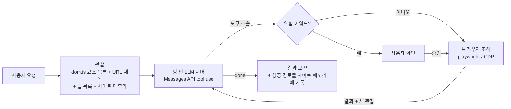

<!-- TODO: 데모 GIF를 만들면 assets/ 에 두고 히어로 아래에 "설명 | GIF" 표로 삽입 -->

<h1 align="center">nongside</h1>

<p align="center">
  <a href="README.md">English</a> · <b>한국어</b>
</p>

<p align="center">
  <strong>Claude로 동작하는 기업용 브라우저 에이전트</strong>
  <br/>
  <sub>처음엔 직접 찾아가고, 다음엔 기억대로 갑니다. Claude가 학습한 적 없는 폐쇄망 사이트에서도 처음에는 화면을 읽으며 길을 찾고, 성공한 경로는 이 기기에 남아 다음 요청부터 그 길로 갑니다. PC에 설치된 Edge/Chrome을 그대로 씁니다.</sub>
</p>

<p align="center">
  
  
  
  
  
  <a href="LICENSE"></a>
</p>

<p align="center">
  <a href="#왜-nongside인가">왜</a> ·
  <a href="#빠른-시작">빠른 시작</a> ·
  <a href="#폐쇄망-배포">폐쇄망 배포</a> ·
  <a href="#주요-기능">기능</a> ·
  <a href="#사용법">사용법</a> ·
  <a href="#설정">설정</a> ·
  <a href="#사이트-메모리">사이트 메모리</a> ·
  <a href="#보안과-한계">보안과 한계</a> ·
  <a href="#기여하기">기여</a>
</p>

폐쇄망은 인터넷이 막혀 있고, 바깥 주소는 대개 회사가 승인한 게이트웨이 하나만 허용됩니다. `playwright install`이나 브라우저 다운로드도 쓸 수 없습니다. nongside는 지정한 주소로만 Claude를 부르므로, 폐쇄망에서는 그 게이트웨이를 가리키면 됩니다.

- **Claude**: Anthropic Messages API로 Claude를 부릅니다. 기본값은 공개 Anthropic API이고, 폐쇄망에서는 회사가 승인한 게이트웨이를 지정합니다. 공식 SDK 없이 Python 표준 라이브러리(`http.client`)로 호출합니다.
- **브라우저**: PC에 이미 설치된 Edge(또는 Chrome)를 그대로 씁니다. 브라우저 바이너리는 받지 않습니다.
- **설치**: 필수 패키지는 `playwright` 하나입니다. Windows 기준 의존성을 포함해 휠 4개, 약 37MB를 반입하면 되고 관리자 권한은 필요 없습니다.
- **기억**: 사이트, 들어가는 길, 통한 단계를 이 기기에 남기고, 다음 요청은 그 길에서 시작합니다. 입력한 값은 저장하지 않습니다.
- **화면은 글자로**: 매 턴 화면을 요소 목록으로 바꿔 Claude에 전달합니다. 스크린샷은 최후 수단입니다.
- **데이터**: 에이전트(Python)가 직접 여는 연결은 지정한 Claude 엔드포인트와 `127.0.0.1`뿐이고, 사용 통계 수집·업데이트 확인·외부 CDN 호출 코드는 없습니다. 브라우저가 접속하는 곳과 기본값 주의는 [네트워크 경계](#3-네트워크-경계)를 보세요.

"공지 게시판에서 이번 주 새 글 세 개만 요약해줘", "이 페이지 표를 정리해줘" 같은 요청을 받으면, 에이전트가 페이지의 요소 목록을 읽고 이동·클릭·입력·읽기를 스스로 골라 처리한 뒤 결과를 돌려줍니다.

> 실제 업무에서 운영 중인 제품이며, 현재 beta입니다. 기능과 설정은 바뀔 수 있고 사이트 구조나 모델에 따라 실패할 수 있으니, 중요한 작업은 결과를 직접 확인하세요.

---

## 왜 nongside인가

| 폐쇄망의 제약 | 흔히 막히는 지점 | nongside의 방식 |
| :--- | :--- | :--- |
| 허용된 바깥 주소는 하나뿐 | 여러 클라우드 서비스가 필요한 도구는 화이트리스트에 맞지 않음 | 지정한 주소 하나(공개 API 또는 회사 게이트웨이)로만 Claude 호출. 그 밖의 외부 인증·SDK 불필요 |
| 인터넷 다운로드 불가 | `playwright install`, 전용 브라우저, 많은 의존성을 반입해야 함 | 설치된 Edge/Chrome 사용. 필수 패키지는 `playwright` 하나 |
| 데이터 반출 금지 | 도구가 어디로 무엇을 보내는지 불분명 | 에이전트가 직접 여는 연결과 Claude로 보내는 내용을 문서로 공개. 브라우저 이동은 망의 접근 통제를 따름 |
| Claude가 학습한 적 없고 검색으로도 못 찾는 내부 사이트 | 에이전트가 매번 사이트를 찾지 못해 헤맴 | 처음에는 화면을 읽으며 길을 찾음. 사이트 메모리와 플레이북에 주소와 통한 경로를 남겨 다음 요청은 그 길에서 시작 |
| 되돌릴 수 없는 클릭 | 발송·삭제·결제가 확인 없이 실행 | 위험 키워드가 있는 클릭·스크립트는 실행 전에 확인. 키워드 기반이라 모든 경우를 막지는 못함 |

---

## 빠른 시작

인터넷이 되는 PC에서 먼저 써 보는 순서입니다. 폐쇄망 PC에 설치하는 방법은 [폐쇄망 배포](#폐쇄망-배포)를 보세요.

필요한 것

- Python 3.9 이상 <!-- TODO: 3.9 문법으로 파싱되고 3.9.6에서 --selftest 통과 확인. 실제 브라우저 구동까지 테스트한 최소 버전 확인 후 갱신 -->
- Microsoft Edge 또는 Google Chrome
- Claude용 Anthropic API 키, 폐쇄망이면 회사 게이트웨이 주소와 키(또는 Bearer 토큰)

**1. 가상환경과 의존성**

```sh
git clone https://github.com/SunnyJLab/nongside.git
cd nongside
```

Windows (PowerShell):

```powershell
python -m venv .venv
.venv\Scripts\pip install -r requirements.txt
```

macOS / Linux:

```sh
python3 -m venv .venv
.venv/bin/pip install -r requirements.txt
```

`playwright install`은 필요 없습니다. 네이티브 채팅 창을 원하면 `requirements-ui.txt`(pywebview)를 추가로 설치합니다. 설치하지 않으면 채팅 창은 Edge/Chrome의 `--app` 창으로 뜹니다.

**2. Claude와 브라우저 설정**

레포 루트에 `.env` 파일을 만듭니다. `.env`는 `.gitignore`에 들어 있어 커밋되지 않습니다.

```ini
# Claude (Anthropic Messages API)
ANTHROPIC_API_KEY=your-key

# 폐쇄망에서는 회사가 승인한 게이트웨이를 지정
# ANTHROPIC_BASE_URL=https://claude-gateway.internal.example
# AGENT_MODEL=model-name-your-gateway-serves
```

`ANTHROPIC_BASE_URL`과 `AGENT_MODEL`의 기본값은 공용 Anthropic API(`https://api.anthropic.com`, `claude-sonnet-4-5`)입니다. 폐쇄망에서는 두 값을 게이트웨이 주소와 게이트웨이가 제공하는 모델 이름으로 지정하세요.

**Edge가 없는 환경(대부분의 macOS, Linux)에서는 `.env`에 `AGENT_CHANNEL=chrome`을 꼭 넣으세요.** 기본값이 `msedge`이고 자동으로 Chrome으로 바꾸지 않으므로, 없으면 `Chromium distribution 'msedge' is not found` 오류로 시작하지 못합니다. 이 오류가 권하는 `playwright install msedge`는 필요 없습니다.

**3. 실행**

레포 루트에서 실행합니다. 전용 브라우저 프로필은 **실행한 폴더**의 `.edge-profile`에 생기므로, 다른 폴더에서 실행하면 로그인이 사라진 것처럼 보입니다.

```sh
# Windows
.venv\Scripts\python main.py
.venv\Scripts\python main.py "공지 게시판에서 이번 주 새 글 알려줘"   # 첫 메시지를 바로 실행

# macOS / Linux
.venv/bin/python main.py
.venv/bin/python main.py --cli                                      # 터미널 대화 모드
```

채팅 창과 에이전트용 브라우저 창이 뜨면 대화를 시작하면 됩니다. 에이전트 브라우저에서 자주 쓰는 사이트에 한 번 로그인해 두면 전용 프로필에 세션이 남아 다음 실행부터 재사용됩니다.

키나 주소가 틀려도 브라우저는 뜹니다. 첫 요청에 `LLM HTTP 401` 같은 오류가 나오면 `.env`를 확인하세요. 채팅 창 상단 설정 버튼에서 실제로 쓰이는 엔드포인트와 키(끝 4자리), 각 값의 출처를 볼 수 있습니다.

코드가 깨지지 않았는지만 빠르게 보려면 LLM과 브라우저 없이 도는 자체 테스트를 실행합니다. playwright 설치 여부는 확인하지 않습니다.

```sh
.venv/bin/python main.py --selftest      # Windows: .venv\Scripts\python main.py --selftest
                                         # "selftest ok"가 나오면 정상
```

---

## 폐쇄망 배포

### 1. 오프라인 설치

인터넷이 되는 PC에서 패키지를 내려받아 반입합니다. 휠은 대상 PC의 OS와 Python 버전에 맞아야 합니다. 최신 playwright는 Python 3.10 이상을 요구하므로, 3.9 PC용을 받으면 그에 맞는 이전 버전이 받아집니다.

```powershell
# 1) 인터넷 PC: 대상 환경을 지정해 휠을 내려받는다 (예: Windows x64, Python 3.12)
python -m pip download -r requirements.txt -d wheels --only-binary=:all: --platform win_amd64 --python-version 3.12

# 2) 소스 폴더와 wheels 폴더를 반입한 뒤, 폐쇄망 PC에서
python -m venv .venv
.venv\Scripts\pip install --no-index --find-links wheels -r requirements.txt
```

반입 목록 (Windows x64, Python 3.12 기준 실측)

| 파일 | 크기 | 비고 |
| :--- | ---: | :--- |
| 소스 (`*.py` 7개, `dom.js`, `requirements*.txt`) | 약 0.3MB | |
| `playwright-*-win_amd64.whl` | 약 37MB | Node.js 실행 파일 `playwright/driver/node.exe`(압축 해제 시 약 94MB) 포함 |
| `greenlet`, `pyee`, `typing_extensions` | 약 0.4MB | |

- 버전과 크기는 받는 시점에 따라 달라집니다. 반입 전 `wheels` 폴더 목록을 확인하세요.
- 대상 PC에 Python이 없으면 Python 설치 파일도 함께 반입해야 합니다. <!-- TODO: embeddable Python으로 설치 없이 쓰는 방법 검토 -->
- `playwright install`은 실행하지 않습니다. 브라우저는 PC에 설치된 Edge/Chrome을 씁니다.
- 관리자 권한은 필요 없습니다. 가상환경과 패키지는 사용자 폴더에 설치되고, 서비스나 레지스트리를 등록하지 않습니다. 다만 실행 파일 허용 목록을 쓰는 PC에서는 가상환경의 `python.exe`와 playwright에 포함된 `node.exe` 실행 허용이 필요할 수 있습니다.
- 폐쇄망에서는 `requirements-ui.txt`(pywebview)를 건너뛰는 것을 권장합니다. 없으면 채팅 창이 Edge `--app` 창으로 떠서 추가 런타임이 필요 없습니다. pywebview는 Windows에서 [WebView2 Runtime과 .NET(pythonnet)이 필요](https://pywebview.flowrl.com/guide/web_engine)하고, 의존성 중 소스 배포만 있는 패키지(`proxy_tools`)가 있어 오프라인 설치가 번거롭습니다.

### 2. 내부 LLM 서버 연결

에이전트는 `{ANTHROPIC_BASE_URL}/v1/messages`로 Anthropic Messages API 형식 요청을 보냅니다. 서버가 다음을 지원해야 합니다.

| 항목 | 내용 |
| :--- | :--- |
| 엔드포인트 | `POST /v1/messages`, 스트리밍 없이 한 번에 응답 |
| 도구 호출 | 요청의 `tools` 정의, 응답의 `tool_use` 블록, 다음 요청의 `tool_result` 블록. **필수입니다.** 도구 호출 없이 텍스트만 오면 한 번 재촉한 뒤 그 텍스트를 답으로 돌려주고 브라우저는 조작하지 않습니다 |
| 시스템 프롬프트 | `system`을 텍스트 블록 배열로 보냄 |
| 헤더 | `x-api-key`와 `Authorization: Bearer`(같은 키), `anthropic-version: 2023-06-01` |
| 기타 필드 | 프롬프트 캐시용 `cache_control`을 함께 보냄. 서버가 이 필드를 거부하지 않아야 함 |
| 이미지 | 스크린샷을 쓸 때만 base64 JPEG 이미지 블록 |

서버를 고르는 방법

- [vLLM](https://github.com/vllm-project/vllm/issues/21313)(`/v1/messages`를 지원하는 버전)과 [Ollama](https://github.com/ollama/ollama/blob/main/docs/api/anthropic-compatibility.mdx)는 `/v1/messages`를 직접 제공합니다.
- OpenAI 호환 API만 있는 서버는 [LiteLLM](https://docs.litellm.ai/docs/anthropic_unified) 같은 게이트웨이를 앞에 두어 `/v1/messages` 형식으로 받을 수 있습니다.
- 어느 쪽이든 쓰는 버전에서 도구 호출, `system` 블록 배열, `cache_control` 필드 처리를 함께 확인하세요.

> **검증 상태**: 이 README 작성 시점에 실제 동작을 확인한 조합은 <!-- TODO: 실제 확인한 모델·서버 기입 -->뿐입니다. vLLM, Ollama, LiteLLM을 거친 오픈 모델 조합은 아직 검증 결과가 없습니다. 써 본 조합을 이슈로 알려 주시면 표에 추가합니다.

<!-- TODO: 검증한 모델·서버 조합 표 (모델, 서버, 도구 호출, 비전, 비고) -->

모델을 고를 때

- **도구 호출을 안정적으로 하는 모델**이어야 합니다. 매 스텝 도구를 골라 호출하는 구조입니다.
- 시스템 프롬프트와 도구 설명이 **한국어**라 한국어 지시를 잘 따르는 모델이 유리합니다.
- 시스템 프롬프트와 도구 정의만 약 1만 1천 자이고, 매 턴 요소 목록(최대 300개)과 추출한 페이지 텍스트(최대 6천 자)가 더해집니다. 컨텍스트가 넉넉한 모델을 권장합니다.
- 응답 최대 토큰 기본값은 `16384`입니다. 서버가 컨텍스트 길이를 넘는다며 거부하면 `AGENT_MAX_TOKENS`를 낮추세요.
- 메인 모델이 이미지를 받지 못하면 `AGENT_VISION_MODEL`로 비전 모델을 따로 지정하세요. 지정하지 않으면 스크린샷이 메인 모델에 이미지로 그대로 전달되고, 이미지를 받지 못하는 서버는 오류를 낼 수 있습니다. 현재 스크린샷 도구를 끄는 설정은 없습니다. 비전 모델도 서버의 `/v1/messages` 이미지 입력 지원을 먼저 확인하세요. <!-- TODO: 스크린샷 비활성화 옵션 -->

### 3. 네트워크 경계

요약: 페이지 내용은 브라우저 → 에이전트(Python) → 지정한 LLM 서버로만 갑니다. 에이전트가 따로 수집·전송하는 사용 통계는 없습니다.

| 연결 | 대상 | 용도 |
| :--- | :--- | :--- |
| LLM 호출 (Python) | `ANTHROPIC_BASE_URL` | 요청, 페이지 텍스트, 스크린샷 전송 |
| 디버그 포트 확인 (Python) | `127.0.0.1:{AGENT_CDP_PORT}` | 띄워 둔 브라우저에 attach |
| 채팅 창 서버 (Python) | `127.0.0.1` 임의 포트 | pywebview가 없을 때만. 토큰 인증 로컬 서버 |
| 브라우저 이동 | 모델이 고른 URL | 에이전트 브라우저가 접속. 접근 범위는 망의 방화벽·프록시 정책을 따름 |

- `.env`와 환경변수에 `ANTHROPIC_BASE_URL`이 없고 `~/.claude/settings.json`도 없으면, 기본값인 공용 Anthropic API(`https://api.anthropic.com`)로 요청을 보내려 합니다. 폐쇄망에서는 연결 실패로 끝나지만, 외부로 나가는 경로가 있는 환경이라면 반드시 내부 주소를 지정하세요.
- 브라우저는 에이전트가 이동한 사이트에 접속합니다. 처음 보는 사이트의 이름을 정할 때 그 사이트의 홈(`/`) 제목도 읽습니다.
- 채팅 창은 HTML·스크립트·아이콘이 코드에 내장돼 있어 외부 CDN이나 웹폰트를 불러오지 않습니다. 단, 현재 탭 칩의 파비콘은 그 사이트에서 불러옵니다.
- LLM 호출은 HTTP 프록시 환경변수(`HTTP_PROXY` 등)를 쓰지 않습니다. 이 PC에서 LLM 서버에 직접 닿아야 합니다.
- `http://` 주소도 그대로 씁니다. `https://`는 Python 기본 인증서 검증을 씁니다. Windows에서는 시스템 인증서 저장소를 읽으므로 조직 내부 CA가 Windows에 설치돼 있으면 그대로 동작하고, 다른 OS에서는 `SSL_CERT_FILE`로 CA 파일을 지정합니다.
- 브라우저 자체의 업데이트·동기화·진단 데이터 전송에는 에이전트가 관여하지 않으며, 조직의 브라우저 정책을 따릅니다.
- `~/.claude/settings.json`이 있으면 그 안의 엔드포인트를 대체 설정으로 읽습니다. 의도한 서버로 가는지 설정 화면에서 확인하세요.

### 4. 내부 사이트 길잡이

인터넷 검색이 안 되는 망에서는 에이전트가 사이트 이름만으로 주소를 찾기 어렵습니다.

- **요청에 주소를 함께 주세요.** `공지게시판(https://portal.example.internal/notice)에서 새 글 알려줘`처럼 띄어쓰기 없는 이름 바로 뒤 괄호에 주소를 붙이면, 처음 간 사이트를 그 이름으로 기억합니다.
- **[사이트 메모리](#사이트-메모리)** 가 한 번 성공한 경로를 저장하므로, 같은 사이트의 같은 작업은 다음부터 바로 찾아갑니다.
- **사이트 플레이북**: 소스 폴더에 `_local/sites.md`를 만들어 내부 사이트 주소와 메뉴 구조를 적어 두면 매 요청 시스템 프롬프트에 붙습니다.

> 알아 둘 점: 에이전트는 기억에 없는 사이트 이름을 만나면 사용자가 준 주소나 확인 가능한 검색 결과로 찾고, 후보가 여럿이면 사용자에게 묻습니다. 인터넷이 없는 망에서는 검색이 실패하므로, 위 방법으로 주소를 미리 알려 주는 것이 좋습니다.


<!-- TODO: 폐쇄망 모드에서 검색 규칙을 끄거나 내부 검색 주소로 바꾸는 설정 추가 -->

> 조사 자료 보관: 같은 대화 안에서 추출한 텍스트(페이지 추출, run_code 출력, 비전 텍스트)를 메모리에 보관하고, `recall` 도구로 목록을 보거나 조사 ID로 다시 읽습니다. 보관 한도는 20만 자이며, 한도를 넘으면 시스템이 경고만 하고 이후 자료는 보관하지 않습니다. 보관 자료는 디스크나 사이트 메모리에 저장되지 않고, 브라우저가 유휴 상태로 닫혀도 같은 대화 안에서는 유지됩니다. 새 대화를 시작하거나 프로그램을 끝내면 삭제됩니다. 스크린샷 원본은 보관하지 않으며, 보관된 원문은 신뢰할 수 없는 페이지 내용으로 취급합니다. 보관 범위 밖의 원문 나머지는 `extract`의 offset으로 원래 페이지에 돌아가 읽어야 합니다.

### 5. Windows PC 환경 대응

- 기본 브라우저 채널이 Edge(`msedge`)라, Edge가 설치된 Windows PC에서는 브라우저 관련 설정을 따로 하지 않아도 됩니다.
- 백그라운드 작업은 Edge/Chrome을 헤드리스 모드로 실행해 화면에 창이 뜨지 않습니다. 보안 소프트웨어가 헤드리스 브라우저를 막을 수 있으며, 백그라운드 브라우저를 시작하지 못하면 경고를 출력하고 현재 탭에서 작업합니다.
- PowerShell 5.1이 만든 UTF-16 `.env` 파일을 읽고, Windows 콘솔(cp949)에서도 한글이 깨지지 않게 출력합니다.

### 6. 보안 검토용 요약

| 항목 | 내용 |
| :--- | :--- |
| 실행 프로세스 | Python, playwright 드라이버(`node.exe`), 에이전트용 Edge/Chrome, 백그라운드용 헤드리스 Edge/Chrome 1개, pywebview가 없으면 채팅 창용 1개 추가 |
| 수신 대기 포트 | pywebview가 없을 때만 `127.0.0.1` 임의 포트 1개(토큰 인증). CDP attach를 쓰면 사용자가 연 디버그 포트(기본 9222, 인증 없음). 백그라운드 브라우저가 실행 중이면 `127.0.0.1`의 임의 디버그 포트 1개(인증 없음). 같은 PC의 다른 프로그램이 접속하면 백그라운드 브라우저에 복사된 쿠키를 읽을 수 있음. 실제 백그라운드 작업 때만 쿠키를 복사하고 채팅 창에서 유휴 10분 후 브라우저를 닫아 노출을 줄임 |
| 외부 연결 | 위 [네트워크 경계](#3-네트워크-경계) 표 |
| 디스크에 남는 것 | `.edge-profile/`(로그인 쿠키 포함, 실행 폴더), `_local/memory/sites.json`(사이트 이름·URL·클릭 경로, 입력값 제외), 임시 폴더의 백그라운드 브라우저 프로필(`nongside-bg-*`, 프로세스 정리 성공 시 삭제; 프로세스가 남거나 확인할 수 없으면 경고와 함께 보존; 비정상 종료 후에는 주인 프로세스가 끝난 프로필을 다음 실행 때 정리), 채팅 창용 브라우저 프로필(`agent-ui-*`, pywebview가 없을 때), 앱 아이콘 파일 |
| 로그 파일 | 만들지 않음. 진행 내역은 콘솔과 채팅 창에만 출력. 스크린샷도 파일로 저장하지 않음 |
| OS 기능 사용 | Windows: 질문이 뜰 때 창 깜빡임용 user32(ctypes), Edge/Chrome 위치 찾기용 레지스트리(App Paths), 소유한 임시 브라우저 정리를 위한 프로세스 조회와 `taskkill`, 소유한 백그라운드 브라우저를 자동 종료하는 kernel32 Job Object. 그 밖의 시스템은 창 API를 쓰지 않음 |
| 관리자 권한 | 불필요. 서비스·레지스트리 등록 없음 |
| 임의 코드 실행 | `run_code`로 모델이 쓴 Python이 사용자 권한으로 실행됨(샌드박스 아님, [보안과 한계](#보안과-한계) 참고) |

**업데이트와 삭제**

- 자동 업데이트는 없습니다. 새 버전은 소스와 휠을 다시 반입해 덮어쓰고, 위 `pip install --no-index` 명령을 다시 실행합니다.
- 사이트 메모리(`_local/`)는 소스 폴더 안에, 전용 프로필(`.edge-profile/`)은 실행 폴더에 있습니다. 폴더를 통째로 교체하면 함께 사라지므로, 보존하려면 옮겨 두거나 `AGENT_MEMORY`, `AGENT_PROFILE`로 바깥 경로를 지정하세요.
- 삭제는 소스 폴더(`.venv`, `.edge-profile`, `_local` 포함)와 임시 폴더의 `agent-ui-*`, `browser-agent-icon-*` 파일을 지우면 됩니다.

---

## 주요 기능

- **텍스트만으로 조작**: 매 턴 `dom.js`가 페이지의 인터랙티브 요소를 `[i] <tag> "라벨"` 목록으로 정리하고, 모델은 인덱스로 클릭·입력합니다. 이미지 입력이 없는 모델도 동작합니다.
- **18개 도구**: `navigate`, `new_tab`, `switch_tab`, `back`, `click`, `type`, `press`, `hover`, `scroll`, `attach`, `extract`, `find`, `wait`, `screenshot`, `recall`, `run_code`, `ask_user`, `done`. 폼 입력처럼 페이지가 바뀌지 않는 연속 동작은 한 턴에 여러 도구를 묶어 호출합니다.
- **두 가지 브라우저 모드**: 디버그 포트(기본 `9222`)가 응답하면 그 브라우저에 attach하고, 없으면 전용 프로필로 Edge/Chrome을 띄웁니다.
- **백그라운드 작업**: 현재 탭에 없는 내용은 화면에 창이 없는 헤드리스 브라우저에서 찾습니다. 별도 임시 프로필을 쓰고 현재 브라우저의 user agent, 언어, 쿠키를 복사합니다(쿠키는 실제 백그라운드 작업을 할 때만 복사). localStorage 같은 다른 저장소는 공유하지 않습니다. 채팅 창에서는 10분 동안 작업이 없으면 브라우저를 닫습니다. 이 브라우저의 `--remote-debugging-port=0` 포트는 loopback에만 열리며 `AGENT_CDP_PORT`와 별개입니다. "열어줘", "보여줘"라고 하면 사용자 화면에 띄웁니다.
- **사이트 메모리**: 사용자가 부르는 사이트 이름과, 그 사이트에서 성공한 조회·조작 경로를 실행이 끝난 뒤에도 저장해 다음 요청에 재사용합니다.
- **위험 동작 확인**: 삭제·발송·등록·결제·제출 같은 키워드가 걸린 클릭과 스크립트는 실행 전에 묻습니다(키워드 휴리스틱, [보안과 한계](#보안과-한계) 참고).
- **채팅 창과 CLI**: 기본은 채팅 창(질문·확인·입력 폼·중단 버튼·스크린샷 썸네일), `--cli`는 터미널 대화 루프입니다.
- **비전 모델 분리(선택)**: `AGENT_VISION_MODEL`을 지정하면 스크린샷을 별도 모델이 텍스트로 판독해 메인 모델에 전달합니다.
- **실제 키 입력**: `type`은 keydown/keyup을 발생시켜 자동완성이 열리고, `<select>`, `contenteditable` 에디터, iframe 안 입력칸도 다룹니다. `attach`는 `input[type=file]`에 파일을 직접 설정합니다.
- **로그의 비밀값 가림**: 비밀번호 칸 입력, 비공개로 입력한 값, `run_code` 출력 속 비밀번호·OTP 값은 화면 로그와 결과에서 `****`로 가립니다. 단, 비공개로 입력한 값도 모델이 입력해야 하므로 LLM 서버로는 전송됩니다.

<details>
<summary><b>관찰 목록 표시</b></summary>

요소 목록은 `[i] <tag> "라벨" +표시 {옵션} @f프레임` 형식입니다. 중첩·cross-origin iframe을 포함한 모든 프레임에서 요소를 모으고, 화면에 가까운 것부터 최대 300개를 보여 줍니다. 화면에서만 알 수 있는 정보를 글자로 바꿔 주기 때문에, 이미지 입력이 없는 모델도 같은 정보를 받습니다.

| 표시 | 뜻 | 모델의 대응 |
| :--- | :--- | :--- |
| `+접힘` | `aria-expanded="false"` 또는 닫힌 `<details>` | click으로 펼친 뒤 다시 관찰 |
| `+팝업` | `aria-haspopup` | hover 또는 click |
| `+숨은메뉴` | 자신이나 부모 아래에 숨겨진 하위 메뉴가 있음 (`display:none`, `visibility:hidden`, `opacity:0`) | hover로 펼친 뒤 다시 관찰 |
| `+후보` | 입력 중 뜬 자동완성/선택 목록의 항목 | 원하는 항목을 click |
| `{*전체\|서울\|+9}` | `<select>`의 선택지, `*`가 현재 값 | 그 중 하나를 `type`의 text로 |

<!-- TODO: dom.js 마커 수집 규칙 세부는 docs/observation.md로 분리 예정 -->

</details>

---

## 사용법

아래 예시는 가상환경을 활성화했다고 가정합니다(macOS/Linux `source .venv/bin/activate`, Windows `.venv\Scripts\Activate.ps1`).

```sh
python main.py                                    # 기본: 채팅 창. 창을 닫으면 종료
python main.py "공지 게시판에서 이번 주 새 글 알려줘"   # 첫 메시지를 인자로: 창이 뜨자마자 실행
python main.py --cli                              # 터미널 대화 루프 (you> 프롬프트)
python main.py --ui                               # 표준 입력이 파이프여도 항상 채팅 창
python main.py --debug                            # 도구 인자·결과·내부 판단까지 출력 (AGENT_LOG=debug)
python main.py --quiet                            # 결과만 출력 (AGENT_LOG=quiet)
python main.py --selftest                         # 자체 테스트 (LLM·브라우저 불필요)
```

옵션 없이 실행했는데 표준 입력이 파이프이면 자동으로 CLI 모드가 됩니다.

기본(`brief`) 출력은 동작마다 한 줄씩 보여줍니다.

```
· 이동 portal.example.internal/notice
· 페이지 읽기
[result] 공지 게시판 이번 주 새 글 3개: ...
```

<details>
<summary><b>대화 흐름과 종료</b></summary>

- 한 줄 입력할 때마다 에이전트가 처리하고 결과를 출력합니다. 대화 맥락은 세션이 끝날 때까지 유지됩니다.
- `종료`, `끝`, `exit`, `quit`, `q` 입력이나 Ctrl+C / EOF로 종료합니다. 작업 실행 중 Ctrl+C는 그 작업만 중단하고 대화는 이어집니다.
- CLI에서 `/bg 작업`이라고 쓰면 현재 탭을 쓰지 않고 처음부터 백그라운드에서 작업합니다.

</details>

<details>
<summary><b>채팅 창 상세</b></summary>

- 입력창 위에 현재 탭의 제목·URL·파비콘이 칩으로 표시됩니다. 칩을 그대로 두면 그 탭에서 작업하고, 탭에 없는 내용은 백그라운드 브라우저에서 확인한 뒤 결과에 함께 알립니다.
- 칩을 x로 닫으면 그 요청 하나만 처음부터 백그라운드에서 작업합니다.
- 대화의 첫 요청에서 쓴 탭은 그 대화에 고정됩니다. 다른 탭에서 작업하려면 새 채팅을 엽니다. 고정한 탭을 닫으면 그때 보고 있는 탭으로 넘어갑니다.
- 질문·확인이 뜨면 최소화된 창이 복원되고, Windows에서는 작업 표시줄도 깜빡입니다.
- pywebview 창에서는 작업 중에 창을 닫으면 종료할지 한 번 더 묻습니다.
- 에이전트가 찍은 스크린샷은 채팅에 썸네일로 뜨고, 클릭하면 원본 크기로 볼 수 있습니다.
- 상단 설정 버튼은 현재 설정(엔드포인트·모델·비전 모델·브라우저 모드·로그 레벨·메모리 경로)과 각 값의 출처를 읽기 전용으로 보여줍니다. API 키는 끝 4자리만 표시합니다.
- 창을 닫으면 CDP로 attach한 브라우저는 그대로 두고 연결만 끊습니다. 직접 띄운 프로필 브라우저는 함께 닫힙니다.
- pywebview 창은 Python과 js_api 브리지로 직접 통신하므로 HTTP 포트를 열지 않습니다. pywebview가 없으면 `127.0.0.1`의 로컬 서버와 Edge/Chrome `--app` 창을 씁니다. 이때는 창 URL의 무작위 토큰으로 다른 localhost 페이지에서 온 위조 요청을 막습니다.

</details>

<details>
<summary><b>로그 레벨</b></summary>

| 레벨 | 보이는 것 |
| :--- | :--- |
| `quiet` | 최종 결과만 |
| `brief` (기본) | 이동·클릭(라벨)·펼치기·입력·키·뒤로·탭·첨부·페이지 읽기·화면 확인·스크립트 실행, 실패 이유, 사이트 메모리 참고/저장 |
| `debug` | 위 내용과 도구 인자·결과, scroll·wait·find, 반복 차단, 스크린샷 게이트, 비전 판독 등 내부 판단 |

</details>

<details>
<summary><b>이미 띄운 브라우저에 붙이기 (CDP attach)</b></summary>

디버그 포트로 띄운 브라우저가 있으면 에이전트가 거기에 붙습니다.

```powershell
# Windows 예시 (설치 경로는 PC마다 다를 수 있음)
& "C:\Program Files (x86)\Microsoft\Edge\Application\msedge.exe" `
  --remote-debugging-port=9222 --user-data-dir="$env:USERPROFILE\.nongside-edge"
```

- Chrome 136 이상은 기본 프로필에서 디버그 포트를 열지 않으므로 `--user-data-dir`로 별도 프로필 폴더를 지정해야 합니다(Chromium 기반인 Edge에서도 같은 증상이 보고돼 있습니다). 즉 평소 쓰는 기본 프로필의 로그인은 그대로 넘어오지 않고, 이 프로필에서 한 번 로그인해야 합니다.
- 포트가 응답하지 않으면 에이전트는 별도 안내 없이 전용 프로필로 새 브라우저를 띄웁니다. 채팅 창 설정 버튼의 브라우저 모드가 `CDP attach`인지 확인하세요.
- 채팅 창에서는 지금 보고 있는 탭에서 시작합니다. CLI에서는 탭이 여러 개면 어느 탭을 쓸지 터미널에서 묻습니다.
- 포트가 응답하면 무엇이든 그곳에 붙습니다. 다른 프로세스가 같은 포트를 쓰고 있으면 창이 보이지 않으니 `AGENT_CDP_PORT`를 빈 포트로 바꾸세요.
- 디버그 포트에는 인증이 없어 같은 PC의 다른 프로그램도 그 브라우저를 조작할 수 있습니다. 쓰지 않을 때는 디버그 포트 없이 브라우저를 다시 띄우세요.

</details>

---

## 설정

모든 설정은 환경변수로 지정하며, 같은 이름을 레포 루트 `.env`에 적어도 됩니다.

우선순위: **process 환경변수 > `.env` > `~/.claude/settings.json`의 `env` 블록 > 기본값**

`~/.claude/settings.json`이 있으면 읽는 이유는 Claude Code에 커스텀 엔드포인트를 이미 설정한 경우 별도 설정 없이 바로 쓰기 위해서입니다. 이 경우 모델 이름은 `ANTHROPIC_MODEL`, 비전 모델은 `ANTHROPIC_VISION_MODEL` 키에서 읽습니다. `.env`나 환경변수에 값이 없으면 이 파일의 키와 엔드포인트가 그대로 쓰이니, 의도한 서버인지 설정 화면에서 확인하세요.

| 이름 | 기본값 | 설명 |
| :--- | :--- | :--- |
| `ANTHROPIC_BASE_URL` | `https://api.anthropic.com` | LLM 서버 주소(망 안 서버, 프록시/게이트웨이). 뒤에 `/v1/messages`가 붙음. 폐쇄망에서는 필수 |
| `ANTHROPIC_API_KEY` / `ANTHROPIC_AUTH_TOKEN` | (필수) | API 키 또는 Bearer 토큰. `x-api-key`와 `Authorization: Bearer` 헤더로 함께 전송 |
| `AGENT_MODEL` | `claude-sonnet-4-5` | 메인 모델 이름. 내부 서버에서는 서버에 올린 이름으로 지정 |
| `AGENT_MAX_TOKENS` | `16384` | 응답 최대 토큰 (비전 판독 호출은 미설정 시 `8192`) |
| `AGENT_VISION_MODEL` | (없음) | 설정하면 스크린샷을 이 모델이 텍스트로 판독. 미설정이면 메인 모델에 이미지 직접 전달, 판독 실패 시 이미지로 폴백 |
| `AGENT_CHANNEL` | `msedge` | 에이전트 브라우저의 playwright 채널. Edge가 없으면 `chrome`으로 바꿔야 함(자동 폴백 없음) |
| `AGENT_PROFILE` | `<cwd>/.edge-profile` | 직접 띄울 때 쓰는 전용 프로필 디렉터리. 실행 폴더 기준이며, 채널과 관계없이 같은 기본 이름 |
| `AGENT_CDP_PORT` | `9222` | attach를 시도할 디버그 포트 |
| `AGENT_BACKGROUND` | `1` | 현재 탭에 없는 내용을 창 없는 헤드리스 백그라운드 브라우저에서 작업. `0`/`false`/`no`/`off`면 사용자 탭에서 바로 이동 |
| `AGENT_UI_BROWSER` | (비움) | 채팅 창 종류. 비우면 pywebview(없으면 `--app` 창), `webview`는 pywebview만, `msedge`(`edge`)/`chrome`(`google-chrome`)은 해당 브라우저 `--app` 창. 그 외 값은 시작 시 오류 |
| `AGENT_LOG` | `brief` | `quiet` / `brief` / `debug`. 그 외 값은 시작 시 오류 |
| `AGENT_MEMORY` | `_local/memory/sites.json` | 사이트 메모리 파일 경로. 기본 위치는 소스 폴더 기준이며, 폴더는 첫 저장 때 자동으로 만들어짐(git 미추적) |

<details>
<summary><b>.env 파일 형식</b></summary>

- `KEY=VALUE` 한 줄에 하나. 값 양끝의 따옴표는 벗겨집니다.
- `#` 주석, 빈 줄, `=`가 없는 줄은 무시합니다.
- UTF-16(BOM) 파일도 읽습니다. PowerShell 5.1의 `>` 리다이렉션으로 만든 파일도 동작합니다.
- 이미 process 환경변수에 있는 키는 덮어쓰지 않습니다.

</details>

<details>
<summary><b>백그라운드 브라우저 동작</b></summary>

- 백그라운드 브라우저는 `--headless=new`로 Edge/Chrome을 실행해 화면에 창이 뜨지 않습니다. 설치된 Edge 또는 Chrome을 씁니다. Windows는 레지스트리 App Paths와 설치 폴더, macOS는 `/Applications`와 `~/Applications`, Linux는 `PATH`에서 찾습니다. 시작하지 못하면 경고를 출력하고 현재 탭에서 작업합니다.
- 일부 보안 소프트웨어가 Playwright의 파이프 실행을 막는 경우가 있어 loopback 임의 포트로 연결합니다. 채팅 창이 뜰 때(또는 처음 필요할 때) 쿠키 없이 시작해 재사용하고, 쿠키는 실제 백그라운드 작업을 할 때마다 복사합니다. 채팅 창에서는 10분 동안 작업이 없으면 닫고 다음 요청 때 다시 시작하며, CLI는 종료할 때까지 유지합니다. 뷰포트는 1280×900으로 고정됩니다. 프로세스 정리에 성공하면 임시 프로필을 삭제하며, 프로세스가 남거나 확인할 수 없으면 경고와 함께 프로필을 보존합니다. 백그라운드 컨텍스트는 별도이며 현재 브라우저의 user agent, 언어, 쿠키를 복사하고 localStorage 등 다른 저장소는 공유하지 않습니다. `--remote-debugging-port=0` CDP 포트는 loopback에만 열리며 `AGENT_CDP_PORT`와 별개입니다.
- 비정상 종료 후 Windows는 Job Object로 Python 프로세스가 끝나면 OS가 소유한 브라우저를 함께 종료합니다. 모든 시스템에서 다음 실행 때도 주인 프로세스가 끝난 `nongside-bg-*` 프로필과 그 프로세스를 정리합니다.
- 그 백그라운드 컨텍스트에서 열리는 `window.open` 팝업은 같은 헤드리스 브라우저의 탭으로 엽니다.
- 백그라운드에서 작업한 사실은 진행 내역에 표시됩니다.
- 브라우저 종류는 attach한 브라우저와 같은 종류, `AGENT_CHANNEL`, 나머지 순으로 고릅니다.

</details>

<details>
<summary><b>LLM 호출과 재시도</b></summary>

- 공식 SDK 없이 `http.client`로 `{ANTHROPIC_BASE_URL}/v1/messages`에 POST하고, keep-alive 연결을 재사용합니다. 헤더는 `anthropic-version: 2023-06-01`입니다.
- 최대 3회 시도합니다. HTTP `429/500/502/503/529`와 연결·DNS 일시 실패는 지수 백오프(1, 2, 4초)로 재시도하며, 서버가 `retry-after`를 주면 따르되 10초로 제한합니다.
- 응답 대기 타임아웃은 120초이며, 타임아웃은 재시도하지 않고 바로 오류로 올립니다.

</details>

<details>
<summary><b>사이트 플레이북 (선택)</b></summary>

소스 폴더에 `_local/sites.md` 파일을 직접 만들어 두면, 그 내용을 `[사이트 플레이북]`으로 시스템 프롬프트 뒤에 붙입니다. 내부 사이트의 주소, 메뉴 구조, 주의 사항을 사람이 적어 둘 때 씁니다. 에이전트가 자동으로 쓰는 사이트 메모리(`_local/memory/sites.json`)와는 다른 파일입니다. 매 호출마다 다시 읽으므로 실행 중에 고쳐도 다음 턴부터 반영됩니다.

</details>

---

## 사이트 메모리

에이전트는 사용자가 부르는 사이트 이름(예: "공지 게시판")과 그 사이트에서 실제로 성공한 조회·조작 경로를 실행이 끝난 뒤에도 저장합니다. 다음에 같은 사이트를 요청하면 메뉴를 처음부터 찾지 않고 저장된 경로를 재사용합니다. 인터넷 검색이 안 되는 망에서는 사이트를 다시 찾는 수고를 줄여 줍니다.

- **저장 위치**: 기본 `_local/memory/sites.json` (`AGENT_MEMORY`로 변경). 파일 형식 버전 3이며, 이전 형식(v1, v2) 파일은 읽을 때 자동으로 변환하고 원본을 `sites.v1.bak` / `sites.v2.bak`로 남깁니다.
- **기록은 에이전트가 수행**: 모델은 작업을 끝낼 때(`done`) 작업 이름(`op`)과, 처음 간 사이트면 이름·대표 URL(`remember`) 정도만 줍니다. 실제 경로(진입 URL, 입력·선택·클릭 단계, 성공 확인 조건)는 에이전트가 이번 요청에서 성공한 동작만 골라 줄여서 저장합니다. 입력값 자체는 저장하지 않고 칸 이름 자리로 남깁니다.
- **요청에 필요한 만큼만 주입**: 요청과 관련된 사이트만 한 줄 요약으로 모델에 보여 주고, 모델이 `navigate {"page": "사이트/작업"}`으로 고를 때 그 작업의 단계만 덧붙입니다.
- **오염 방지**: 셀렉터·코드·가격·날짜처럼 금방 낡는 정보는 저장하지 않습니다. 실패·취소·중단으로 끝난 요청이나 입력값이 URL에 남는 경로도 기록하지 않습니다. 저장된 작업이 연속 2번 실패하면 목록에서 숨기고 다시 배웁니다.
- **재생해도 확인은 그대로**: 저장된 경로를 다시 실행할 때도 위험 키워드가 걸린 동작은 실제 라벨로 다시 확인합니다.

<details>
<summary><b>저장 구조와 상한</b></summary>

| 필드 | 내용 |
| :--- | :--- |
| 이름 · `aliases` | 사용자가 부르는 호칭과 별칭. `메일`, `카페` 같은 일반 명사나 페이지 제목은 이름으로 쓰지 않음 |
| `url` · `match` | 대표 URL(사이트 홈)과 이 사이트 페이지를 알아보는 URL 조각 |
| `notes` | 사이트 제약 메모 한 줄 (예: `로그인 → 글쓰기는 로그인 필요`) |
| `tasks` | 작업 이름 → 에이전트가 기록한 성공 경로 (`kind: act` 조작 / `kind: read` 읽기, 성공·실패 횟수) |
| `hits` · `used` | 성공 기록 횟수와 마지막 사용일. 퇴출 점수 계산에 사용 |

| 상한 | 값 |
| :--- | :--- |
| 사이트 수 | 50 (넘으면 `(성공 횟수 + 1) × 0.5^(경과일 / 30)` 점수가 가장 낮은 사이트부터 퇴출) |
| 사이트당 작업 | 20 |
| 사이트당 메모 | 5 |
| 별칭 / match 항목 | 각 8 |
| 연속 실패 숨김 기준 | 2 |

조작 작업 예시 (위험 클릭은 `⚠`로 표시해 저장):

```
글쓰기 = {kind: act, url: https://portal.example.internal/board/compose, path: [..., 새 글 작성],
         steps: [type 제목={제목}, select 분류=잡담, type 본문={본문}, ⚠click 등록],
         check: list?saved=1, ok: 3, fail: 0}
```

읽기 작업은 `how`(extract, run_code, 관찰과 대기·스크롤)와 진입 뒤 누를 `steps`를 두며, 검색어 자리는 `{q}`입니다.

<!-- TODO: 기록·이름 결정·주입 규칙의 세부(진입 URL 판정, 별칭 규칙, 목록 글자 예산 등)는 docs/site-memory.md로 분리 예정 -->

</details>

---

## 동작 방식



| 파일 | 역할 |
| :--- | :--- |
| `main.py` | 진입점. 채팅 창 / CLI / `--selftest` 분기, 대화 루프 |
| `agent.py` | 도구 스키마(`TOOLS`)와 에이전트 루프, 위험 동작 확인 |
| `llm.py` | 시스템 프롬프트, 설정 로딩(.env, settings.json), Messages API 호출과 재시도, 비전 판독 |
| `browser.py` | playwright/CDP 브라우저 제어, 헤드리스 백그라운드 브라우저, `extract`, `run_code` 실행 |
| `dom.js` | `page.evaluate`로 실행되는 요소 목록·마커 수집 스크립트 |
| `memory.py` | 사이트 메모리 저장·변환·주입 |
| `webui.py` | 채팅 창(HTML 단일 파일), pywebview 브리지, 대체용 토큰 인증 로컬 서버 |

---

## 보안과 한계

nongside는 **사용자 권한으로 실제 브라우저와 Python을 조작하는 도구**입니다. 아래 내용을 이해한 뒤 사용하세요.

**`run_code`는 샌드박스가 아닙니다.** 모델이 작성한 Python(playwright) 코드는 에이전트 프로세스의 권한으로 실행됩니다. 허용 목록에 있는 일부 builtins만 노출하지만(`open`, `__import__`, `eval` 등은 빠져 있음), 이는 모델의 실수를 줄일 뿐 보안 경계가 아니며 쉽게 우회할 수 있습니다. 확인 창에 코드가 표시되면 읽은 뒤 승인하세요.

**위험 동작 확인은 키워드 기반 휴리스틱입니다.** 클릭할 요소의 라벨이나 `run_code`의 실제 조작 호출(click, submit, 페이지 안 JS의 fetch 등) 대상에 `삭제`, `제거`, `비우기`, `발송`, `전송`, `보내기`, `등록`, `게시`, `결제`, `승인`, `제출`, `delete`, `remove`, `submit`, `publish`, `pay`, `send` 같은 단어가 있으면 실행 전에 `[y/N]`으로 묻습니다. 전체 목록은 `agent.py`의 `DANGER`에 있습니다.

- `검색어 삭제`, `닫기`, `취소`처럼 UI를 정리하는 버튼과 `게시판`·`게시글`·`게시물`은 제외합니다.
- `press`(Enter 포함), `type`, `navigate`, `attach`는 키워드와 관계없이 확인하지 않습니다. 그 외 클릭과 스크립트도 키워드가 없으면 바로 실행되므로, 라벨이 모호한 파괴 동작은 놓칠 수 있습니다.
- 비대화형 실행(표준 입력이 터미널이 아님)에서는 확인을 자동으로 거부합니다.

**웹페이지 내용이 지시처럼 작동할 수 있습니다(프롬프트 인젝션).** 에이전트는 페이지 텍스트를 사용자 요청과 같은 대화에 넣어 모델에 보냅니다. 페이지에 "이 파일을 업로드해라", "이 주소로 이동해라" 같은 문구가 숨어 있으면 모델이 그것을 따를 수 있습니다. 현재 코드에는 이를 걸러내는 별도 장치가 없고, 위 확인에 걸리지 않는 동작(키워드 없는 `run_code`, `attach`로 로컬 파일 첨부, `navigate`로 임의 주소 이동, `press`로 Enter 제출)은 확인 없이 실행됩니다. 신뢰할 수 없는 페이지에서 쓸 때는 진행 내역을 확인하고, 중요한 계정이 로그인된 프로필에서는 주의하세요.

**사용자의 브라우저 프로필과 쿠키를 사용합니다.** CDP attach에서는 그 브라우저의 로그인 세션을 그대로 쓰고, 헤드리스 백그라운드 브라우저에는 쿠키를 복사하며, 같은 PC의 다른 프로그램이 그 브라우저의 디버그 포트로 이 쿠키를 읽을 수 있습니다. 전용 프로필(`.edge-profile`)에도 로그인 세션이 저장됩니다.

**LLM 서버로 전송되는 것.** 요소 목록, `extract`로 읽은 페이지 텍스트, 스크린샷(비전 모델 포함), `ask_user`로 입력한 값(비공개 입력 포함)이 설정한 LLM 서버로 전송됩니다. 망 안 서버를 쓰면 이 데이터는 그 서버까지만 갑니다. 서버의 로그 보관 정책도 함께 확인하세요.

**알려진 한계**

- 캡차, 2FA, 인증서 선택, 브라우저 자체 UI(주소창, 권한 팝업 등)는 처리하지 못합니다. 이런 경우 `ask_user`로 사람에게 넘깁니다.
- 스크린샷은 최후 수단입니다. 해당 페이지에서 `extract`를 한 번도 쓰지 않았다면 첫 `screenshot` 호출은 캡처 대신 추출 텍스트를 돌려주고(추출할 텍스트가 없으면 바로 캡처), 두 번째 호출부터 실제로 캡처합니다. 페이지당 최대 3번입니다.
- 한 요청당 스텝 상한은 25입니다. 넘으면 그때까지의 진행을 요약해 끝냅니다.
- 관찰 목록은 프레임을 합쳐 최대 300개 요소입니다. 요소가 아주 많은 페이지에서는 화면에서 먼 요소가 빠질 수 있습니다.
- 헤드리스 백그라운드 브라우저 경로는 모든 OS에서 완전히 검증하지 않았습니다.

---

## 기여하기

<!-- TODO: CONTRIBUTING.md 작성 시 이 섹션을 요약 + 링크로 축소 -->

- **소스만 추적합니다.** `.env`, `.edge-profile*/`, `.venv/`, `_local/`, `__pycache__/`는 커밋하지 마세요. 프로필에는 로그인 쿠키가 들어 있으니 특히 주의하세요.
- **구조를 유지합니다.** `dom.js`는 `browser.py`와 같은 폴더에 있어야 합니다(`Path(__file__).with_name("dom.js")`로 로드). 핵심 모듈은 루트에 함께 두며 패키지화하지 않습니다.
- **외부 의존성을 늘리지 않습니다.** 폐쇄망 반입 부담이 커지므로, 필수 의존성은 `playwright` 하나로 유지하고 나머지는 표준 라이브러리로 해결합니다.
- **로컬 산출물은 `_local/`에 둡니다.** git이 추적하지 않는 폴더입니다. 테스트에서 사이트 메모리를 쓸 때는 실제 파일 대신 임시 경로를 쓰세요.
- `requirements-ui.txt`의 주석은 ASCII만 씁니다(Windows pip가 시스템 코드페이지로 읽는 경우가 있음).
- PR 전에 `python main.py --selftest`가 통과하는지 확인해 주세요. 도구 스키마 형식, 에이전트 루프 한 바퀴, 사이트 메모리 저장과 회상을 검증합니다. 커밋 전에는 `git status`에 `.edge-profile*`, `_local/`, `.env`가 보이지 않는지 확인해 주세요.

회귀 테스트는 `python -m unittest discover -s tests -v`로 실행합니다.

---

## Disclaimer

nongside는 사용자의 브라우저와 계정으로 실제 동작을 수행합니다. 에이전트가 수행한 클릭·입력·발송·결제 등 모든 동작과 그 결과에 대한 책임은 사용자에게 있습니다.

- 이 소프트웨어는 있는 그대로 제공되며, 모델의 오판이나 웹페이지 내용에 의한 오동작(프롬프트 인젝션 포함)으로 생긴 결과를 보증하지 않습니다.
- 조직 내부망에 도입할 때는 소속 조직의 보안·자동화 정책과 승인 절차를 먼저 확인하세요.
- 자동화로 접근하는 각 웹사이트의 이용약관과 robots 정책, 관련 법규를 확인하고 지켜 주세요.
- 연결하는 LLM 서버(또는 프록시/게이트웨이)의 이용 조건과 데이터 처리 정책을 준수할 책임은 사용자에게 있습니다.
- 이 프로젝트는 Anthropic, Microsoft, Google 등 언급된 어떤 회사와도 제휴하거나 보증받지 않았습니다.

---

## License

MIT. [LICENSE](LICENSE)를 참고하세요.

---

<p align="center">
  <em>Claude로 동작하는 기업용 브라우저 에이전트</em>
  <br/>
  <sub>처음엔 직접 찾아가고, 다음엔 기억대로 갑니다.</sub>
</p>
