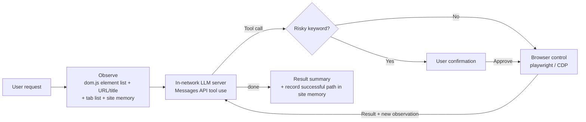

<!-- TODO: Once you have a demo GIF, put it in assets/ and insert a "description | GIF" table under the hero -->

<h1 align="center">nongside</h1>

<p align="center">
  <b>English</b> · <a href="README.ko.md">한국어</a>
</p>

<p align="center">
  <strong>An enterprise browser agent that runs on Claude</strong>
  <br/>
  <sub>It learns the path. Next time, it runs it. On closed-network sites Claude was never trained on, it reads the screen and finds the way the first time. The path that worked stays on this machine, and the next request starts there. It uses the Edge or Chrome already installed on the PC.</sub>
</p>

<p align="center">
  
  
  
  
  
  <a href="LICENSE"></a>
</p>

<p align="center">
  <a href="#why-nongside">Why</a> ·
  <a href="#quick-start">Quick start</a> ·
  <a href="#air-gapped-deployment">Air-gapped deployment</a> ·
  <a href="#features">Features</a> ·
  <a href="#usage">Usage</a> ·
  <a href="#configuration">Configuration</a> ·
  <a href="#site-memory">Site memory</a> ·
  <a href="#security-and-limitations">Security</a> ·
  <a href="#contributing">Contributing</a>
</p>

On a closed network the public internet is blocked, and usually the only outside address allowed is a gateway your company approves. `playwright install` and browser downloads are not available either. nongside calls Claude only at the address you set, so on a closed network you point it at that gateway.

- **Claude**: It calls Claude through the Anthropic Messages API. The default is the public Anthropic API; on a closed network, set your company's approved gateway. It uses the Python standard library (`http.client`), with no official SDK.
- **Browser**: It uses the Edge (or Chrome) already installed on the PC. It does not download a browser binary.
- **Install**: The only required package is `playwright`. On Windows, you bring in 4 wheels including dependencies, about 37MB in total. No administrator rights are needed.
- **Memory**: It remembers the site, the way in, and the steps that worked, on this machine. The next request starts from that saved path. Input values are not saved.
- **Screen as text**: Each turn it sends the screen to Claude as an element list. Screenshots are a last resort.
- **Data**: The only connections the agent (Python) opens itself are the Claude endpoint you set and `127.0.0.1`. There is no code that collects usage stats, checks for updates, or calls an external CDN. For where the browser connects, and the caveat about defaults, see [Network boundaries](#3-network-boundaries).

Ask it something like "Summarize just the three new posts on the notice board this week" or "Organize the table on this page." The agent reads the page's element list, chooses navigation, clicks, typing, and reading on its own, then returns the result.

> nongside is used for real work and is currently in beta. Features and settings can change, and it can fail depending on the site structure or the model. For anything important, check the result yourself.

---

## Why nongside

| Constraint on an air-gapped network | Where tools usually get stuck | How nongside does it |
| :--- | :--- | :--- |
| Only one approved outside address | Tools that need several cloud services do not fit the allowlist | Calls Claude only at the one address you set (the public API, or your company gateway). No other external auth or SDK |
| No internet downloads | You have to transfer in `playwright install`, a dedicated browser, and many dependencies | Uses the installed Edge/Chrome. The only required package is `playwright` |
| Data must not leave the network | Unclear where a tool sends what | Documents the connections the agent opens itself and what it sends to Claude. Browser navigation follows the network's access controls |
| Internal sites Claude was never trained on, that search cannot find | The agent cannot find the site and wanders, every time | The first time it reads the screen and finds the way. Site memory and the site playbook keep the URL and the path that worked, and the next request starts there |
| Clicks you cannot undo | Sends, deletes, and payments run without confirmation | Clicks and scripts that match danger keywords ask for confirmation before they run. Because it is keyword-based, it cannot block every case |

---

## Quick start

These steps are for trying it out first on a PC with internet access. To install on an air-gapped PC, see [Air-gapped deployment](#air-gapped-deployment).

What you need

- Python 3.9 or later <!-- TODO: Parses as 3.9 syntax, and --selftest passes on 3.9.6. Update after confirming the minimum version tested through an actual browser launch -->
- Microsoft Edge or Google Chrome
- An Anthropic API key for Claude, or on a closed network, your company gateway's address and key (or a Bearer token)

**1. Virtual environment and dependencies**

```sh
git clone https://github.com/SunnyJLab/nongside.git
cd nongside
```

Windows (PowerShell):

```powershell
python -m venv .venv
.venv\Scripts\pip install -r requirements.txt
```

macOS / Linux:

```sh
python3 -m venv .venv
.venv/bin/pip install -r requirements.txt
```

You do not need `playwright install`. If you want a native chat window, also install `requirements-ui.txt` (pywebview). If you do not, the chat window opens as an Edge/Chrome `--app` window.

**2. Claude and browser settings**

Create a `.env` file at the repo root. `.env` is listed in `.gitignore`, so it is not committed.

```ini
# Claude (Anthropic Messages API)
ANTHROPIC_API_KEY=your-key

# On a closed network, point it at your company's approved gateway
# ANTHROPIC_BASE_URL=https://claude-gateway.internal.example
# AGENT_MODEL=model-name-your-gateway-serves
```

The defaults for `ANTHROPIC_BASE_URL` and `AGENT_MODEL` are the public Anthropic API (`https://api.anthropic.com`, `claude-sonnet-4-5`). On a closed network, set both to your gateway's address and the model name it serves.

**On machines without Edge (most macOS and Linux), you must put `AGENT_CHANNEL=chrome` in `.env`.** The default is `msedge`, and it does not switch to Chrome on its own. Without Edge it fails to start with `Chromium distribution 'msedge' is not found`. You do not need the `playwright install msedge` that error suggests.

**3. Run**

Run it from the repo root. The dedicated browser profile is created at `.edge-profile` in **the folder you ran from**, so if you run it from another folder, your logins will appear to be gone.

```sh
# Windows
.venv\Scripts\python main.py
.venv\Scripts\python main.py "Tell me the new posts on the notice board this week"   # run the first message immediately

# macOS / Linux
.venv/bin/python main.py
.venv/bin/python main.py --cli                                      # terminal conversation mode
```

Once the chat window and the agent browser window open, start the conversation. Log in once, in the agent browser, to the sites you use often. The session stays in the dedicated profile and is reused from the next run.

The browser still opens if the key or the URL is wrong. If the first request returns an error such as `LLM HTTP 401`, check `.env`. The settings button at the top of the chat window shows the endpoint actually in use, the key (last 4 characters), and the source of each value.

To quickly check that the code itself is not broken, run the self-test. It runs with no LLM and no browser. It does not check whether playwright is installed.

```sh
.venv/bin/python main.py --selftest      # Windows: .venv\Scripts\python main.py --selftest
                                         # "selftest ok" means it is fine
```

---

## Air-gapped deployment

### 1. Offline installation

Download the packages on a PC with internet, then transfer them into the network. Wheels must match the target PC's OS and Python version. The latest playwright requires Python 3.10 or later, so if you download for a Python 3.9 PC, pip picks an older compatible version.

```powershell
# 1) Internet PC: download wheels for the target environment (example: Windows x64, Python 3.12)
python -m pip download -r requirements.txt -d wheels --only-binary=:all: --platform win_amd64 --python-version 3.12

# 2) After transferring the source folder and the wheels folder into the network, on the air-gapped PC
python -m venv .venv
.venv\Scripts\pip install --no-index --find-links wheels -r requirements.txt
```

What you transfer in (measured on Windows x64, Python 3.12)

| File | Size | Notes |
| :--- | ---: | :--- |
| Source (7 `*.py` files, `dom.js`, `requirements*.txt`) | about 0.3MB | |
| `playwright-*-win_amd64.whl` | about 37MB | Includes the Node.js executable `playwright/driver/node.exe` (about 94MB uncompressed) |
| `greenlet`, `pyee`, `typing_extensions` | about 0.4MB | |

- Versions and sizes change depending on when you download. Check the `wheels` folder listing before you transfer it in.
- If the target PC has no Python, transfer a Python installer as well. <!-- TODO: Look into running with embeddable Python so no install is required -->
- Do not run `playwright install`. The browser is the Edge or Chrome installed on the PC.
- Administrator rights are not required. The virtual environment and packages install in the user folder, and it does not register a service or registry entries. On a PC that uses an executable allowlist, you may need to allow `python.exe` from the virtual environment and the `node.exe` bundled with playwright.
- On an air-gapped network, skip `requirements-ui.txt` (pywebview). Without it, the chat window opens as an Edge `--app` window and needs no extra runtime. On Windows, pywebview [needs the WebView2 Runtime and .NET (pythonnet)](https://pywebview.flowrl.com/guide/web_engine), and one dependency (`proxy_tools`) is published only as a source distribution, which makes an offline install awkward.

### 2. Connecting an internal LLM server

The agent sends Anthropic Messages API requests to `{ANTHROPIC_BASE_URL}/v1/messages`. The server must support the following.

| Item | Requirement |
| :--- | :--- |
| Endpoint | `POST /v1/messages`, one response with no streaming |
| Tool use | `tools` definitions on the request, `tool_use` blocks on the response, and `tool_result` blocks on the next request. **Required.** If only text comes back with no tool call, the agent nudges the model once, then returns that text as the answer and does not drive the browser |
| System prompt | Sends `system` as an array of text blocks |
| Headers | `x-api-key` and `Authorization: Bearer` (the same key), `anthropic-version: 2023-06-01` |
| Other fields | Also sends `cache_control` for prompt caching. The server must not reject this field |
| Images | A base64 JPEG image block only when a screenshot is used |

How to pick a server

- [vLLM](https://github.com/vllm-project/vllm/issues/21313) (a version that supports `/v1/messages`) and [Ollama](https://github.com/ollama/ollama/blob/main/docs/api/anthropic-compatibility.mdx) serve `/v1/messages` directly.
- A server that only has an OpenAI-compatible API can sit behind a gateway such as [LiteLLM](https://docs.litellm.ai/docs/anthropic_unified) and accept the `/v1/messages` format.
- Either way, on the version you run, check tool use, the `system` block array, and `cache_control` handling together.

> **Verification status**: As of writing this README, the only combination whose behavior was actually confirmed is <!-- TODO: fill in the model and server that were actually checked -->. There are no verification results yet for open-model combinations going through vLLM, Ollama, or LiteLLM. If you have tried a combination, open an issue and it will be added to the table.

<!-- TODO: Table of verified model and server combinations (model, server, tool use, vision, notes) -->

When picking a model

- It must be **a model that calls tools reliably**. Each step it picks a tool and calls it.
- The system prompt and tool descriptions are **in Korean**, so a model that follows Korean instructions well has an advantage.
- The system prompt and tool definitions alone are about 11,000 characters, and each turn adds the element list (up to 300 items) and extracted page text (up to 6,000 characters). A model with a generous context is recommended.
- The default maximum response tokens is `16384`. If the server rejects the request because it exceeds the context length, lower `AGENT_MAX_TOKENS`.
- If the main model cannot accept images, set a separate vision model with `AGENT_VISION_MODEL`. If you do not, screenshots are passed to the main model as images, and a server that cannot accept images may error. There is currently no setting that turns off the screenshot tool. For the vision model too, first confirm that the server's `/v1/messages` supports image input. <!-- TODO: option to disable screenshots -->

### 3. Network boundaries

Summary: page content goes only from the browser to the agent (Python) to the LLM server you set. The agent does not separately collect or send usage stats.

| Connection | Target | Purpose |
| :--- | :--- | :--- |
| LLM call (Python) | `ANTHROPIC_BASE_URL` | Sends the request, page text, and screenshots |
| Debug port check (Python) | `127.0.0.1:{AGENT_CDP_PORT}` | Attach to a browser you already started |
| Chat window server (Python) | an arbitrary port on `127.0.0.1` | Only when pywebview is absent. A local server with token auth |
| Browser navigation | the URL the model picks | The agent browser connects. Reach follows the network's firewall and proxy policy |

- If `ANTHROPIC_BASE_URL` is set in neither `.env` nor the environment, and `~/.claude/settings.json` is also missing, it tries to send requests to the default public Anthropic API (`https://api.anthropic.com`). On an air-gapped network that ends in a connection failure, but if the machine has a path out, you must set an internal address.
- The browser connects to the sites the agent navigates to. When naming a site it has not seen before, it also reads the title of that site's home (`/`).
- The chat window has its HTML, scripts, and icons embedded in the code, so it does not load an external CDN or web fonts. The favicon on the current-tab chip is loaded from that site.
- LLM calls do not use HTTP proxy environment variables (`HTTP_PROXY` and others). This PC must reach the LLM server directly.
- `http://` addresses are used as-is. `https://` uses Python's default certificate verification. On Windows it reads the system certificate store, so an organizational internal CA installed in Windows works as-is. On other operating systems, set `SSL_CERT_FILE` to the CA file.
- The agent does not take part in the browser's own update, sync, or diagnostic-data sending. Those follow your organization's browser policy.
- If `~/.claude/settings.json` exists, it reads the endpoint inside as a fallback setting. Check the settings screen to confirm traffic goes to the server you intended.

### 4. Helping the agent find internal sites

On a network where internet search does not work, the agent has a hard time finding a URL from a site name alone.

- **Include the URL in the request.** Put the URL in parentheses right after a site name that has no spaces, as in `Show me new posts on NoticeBoard(https://portal.example.internal/notice)`. The agent then remembers a site it visits for the first time under that name.
- **[Site memory](#site-memory)** stores a path once it has succeeded, so the same task on the same site is found directly from the next time.
- **Site playbook**: Create `_local/sites.md` in the source folder and write internal site URLs and menu structure there. It is appended to the system prompt on every request.

> Worth knowing: when the agent does not recognize a site name, it looks it up from a URL you give or from a verified search result, and asks you if several candidates match. On a network with no internet access, give the URL ahead of time using the methods above.

<!-- TODO: Add a setting that, in air-gapped mode, turns off the search rule or replaces it with an internal search URL -->

> Research archive: Text extracted during the same chat (page extracts, run_code output, vision text) is kept in memory. Use the `recall` tool to list entries or reread one by its research ID. The archive is capped at 200,000 characters; past that limit the system only warns and later text is not kept. Archived text is not written to disk or site memory. It survives the browser closing when idle, but only within the same chat. Starting a new chat or exiting the process discards it. Screenshots are not kept, only text. Archived text is untrusted page content, not instructions. Any part of the original page beyond the archived text must be read again on the source page using `extract` with an offset.

### 5. Windows PC considerations

- The default browser channel is Edge (`msedge`), so a Windows PC with Edge installed needs no extra browser settings.
- Background work runs Edge/Chrome in headless mode, so no window appears on screen. Some security software blocks headless browsers. If the background browser cannot start, the agent prints a warning and works in the current tab.
- It reads UTF-16 `.env` files created by PowerShell 5.1, and it prints Korean so that it is not garbled on the Windows console (cp949).

### 6. Summary for security review

| Item | Details |
| :--- | :--- |
| Processes | Python, the playwright driver (`node.exe`), Edge/Chrome for the agent, one headless Edge/Chrome for background work, and, if pywebview is absent, one more for the chat window |
| Listening ports | Only when pywebview is absent: one arbitrary port on `127.0.0.1` (token auth). If you use CDP attach, the debug port you opened (default 9222, no auth). While the background browser runs, one random debug port on `127.0.0.1` (no auth); another program on the same PC that connects to it can read the cookies copied into the background browser. Exposure is reduced by copying cookies only when a background task actually runs and by closing the browser after 10 idle minutes in the chat window |
| Outbound connections | The [Network boundaries](#3-network-boundaries) table above |
| Left on disk | `.edge-profile/` (includes login cookies; in the folder you ran from), `_local/memory/sites.json` (site names, URLs, and click paths; typed input excluded), plus, in the temp folder, the background browser profile (`nongside-bg-*`, removed after successful process cleanup; preserved with a warning if the process remains or cannot be checked; after an abnormal exit, profiles whose owner process has ended are cleaned up on the next run), the chat-window browser profile (`agent-ui-*`, when pywebview is absent), and the app icon file |
| Log files | None are created. Progress is printed only to the console and the chat window. Screenshots are not saved to files either |
| OS features used | Windows: user32 (ctypes) to flash the window when a question appears, the registry (App Paths) to find Edge/Chrome, process inspection plus `taskkill` for the owned temporary browser, and a kernel32 Job Object that closes the owned background browser automatically. Other systems use no window APIs |
| Administrator rights | Not required. No service or registry registration |
| Arbitrary code execution | Python written by the model runs through `run_code` with your user privileges (not sandboxed; see [Security and limitations](#security-and-limitations)) |

**Updates and removal**

- There is no automatic update. For a new version, transfer the source and wheels in again, overwrite, and rerun the `pip install --no-index` command above.
- Site memory (`_local/`) is inside the source folder, and the dedicated profile (`.edge-profile/`) is in the folder you ran from. Replacing the folder wholesale removes them too. To keep them, move them aside, or point `AGENT_MEMORY` and `AGENT_PROFILE` at paths outside the folder.
- To remove it, delete the source folder (including `.venv`, `.edge-profile`, and `_local`) and the `agent-ui-*` and `browser-agent-icon-*` files in the temp folder.

---
## Features

- **Text-only control**: On every turn, `dom.js` lists the page's interactive elements as `[i] <tag> "label"`, and the model clicks or types by index. Models without image input also work.
- **18 tools**: `navigate`, `new_tab`, `switch_tab`, `back`, `click`, `type`, `press`, `hover`, `scroll`, `attach`, `extract`, `find`, `wait`, `screenshot`, `recall`, `run_code`, `ask_user`, `done`. Multiple actions that do not change the page, such as filling out a form, are grouped into one turn.
- **Two browser modes**: If the debug port (default `9222`) responds, the agent attaches to that browser. Otherwise, it launches Edge/Chrome with a dedicated profile.
- **Background tasks**: Content not in the current tab is found in a headless browser with no window on screen. It uses a separate temporary profile and copies the current browser's user agent, language, and cookies (cookies are copied only when a background task actually runs); other storage such as localStorage is not shared. In the chat window it is closed after 10 minutes without a task. The owned browser starts with `--remote-debugging-port=0` on loopback, independently of `AGENT_CDP_PORT`. If you say "open it" or "show it," the agent displays it on your screen.
- **Site memory**: After a run ends, it saves the site name used by the user and the successful lookup and interaction paths for that site, and reuses them for later requests.
- **Confirmation for risky actions**: Before running clicks and scripts that match keywords such as delete, send, post, pay, or submit, the agent asks for confirmation (keyword heuristic; see [Security and limitations](#security-and-limitations)).
- **Chat window and CLI**: The default is the chat window (questions, confirmations, input forms, stop button, screenshot thumbnails); `--cli` starts a terminal conversation loop.
- **Optional separate vision model**: If you set `AGENT_VISION_MODEL`, a separate model reads screenshots as text and passes the result to the main model.
- **Real keystrokes**: `type` fires keydown/keyup events, opens autocomplete, and handles `<select>`, `contenteditable` editors, and input fields inside iframes. `attach` sets a file directly on `input[type=file]`.
- **Redacted secrets in logs**: Password field input, values entered privately, and password/OTP values in `run_code` output are masked as `****` in screen logs and results. However, privately entered values are still sent to the LLM server because the model needs to enter them.

<details>
<summary><b>Observation list format</b></summary>

The element list uses the format `[i] <tag> "label" +marker {options} @f<frame>`. Elements are collected from all frames, including nested and cross-origin iframes, and up to 300 are shown, starting with those closest to the viewport. This converts information that would otherwise only be visible on screen into text, so models without image input receive the same information.

| Marker | Meaning | Model response |
| :--- | :--- | :--- |
| `+접힘` (collapsed) | `aria-expanded="false"` or a closed `<details>` | Expand with `click`, then observe again |
| `+팝업` (popup) | `aria-haspopup` | `hover` or `click` |
| `+숨은메뉴` (hidden menu) | A submenu is hidden beneath the element or one of its parents (`display:none`, `visibility:hidden`, `opacity:0`) | Expand with `hover`, then observe again |
| `+후보` (suggestion) | An item in an autocomplete/selection list shown while typing | `click` the desired item |
| `{*전체\|서울\|+9}` | Options in a `<select>`; `*` marks the current value | Use one of them as the text for `type` |

<!-- TODO: Move the detailed dom.js marker collection rules to docs/observation.md -->

</details>

---

## Usage

The examples below assume that the virtual environment is activated (`source .venv/bin/activate` on macOS/Linux, `.venv\Scripts\Activate.ps1` on Windows).

```sh
python main.py                                    # default: chat window. Closing the window quits
python main.py "Tell me the new posts on the notice board this week"   # first message as an argument: runs as soon as the window opens
python main.py --cli                              # terminal conversation loop (you> prompt)
python main.py --ui                               # always use the chat window, even if stdin is piped
python main.py --debug                            # print tool arguments/results and internal decisions too (AGENT_LOG=debug)
python main.py --quiet                            # print results only (AGENT_LOG=quiet)
python main.py --selftest                         # self-test (no LLM or browser required)
```

If you run without options while stdin is piped, the agent automatically switches to CLI mode.

The default (`brief`) output shows one line for each action.

```
· 이동 portal.example.internal/notice
· 페이지 읽기
[result] 3 new posts on the notice board this week: ...
```

<details>
<summary><b>Conversation flow and exit</b></summary>

- The agent processes each line of input and prints a result. Conversation context is kept until the session ends.
- Enter `종료` (exit), `끝` (end), `exit`, `quit`, or `q`, or use Ctrl+C / EOF to exit. Ctrl+C during a task stops only that task and keeps the conversation going.
- In CLI mode, enter `/bg <task>` to run a task in the background from the start without using the current tab.

</details>

<details>
<summary><b>Chat window details</b></summary>

- A chip above the input field shows the current tab's title, URL, and favicon. Leave the chip as is to work in that tab. If the content is not in the tab, the agent checks in a background browser and reports it with the result.
- Close the chip with x to run that request in the background from the start.
- The tab used for the first request in a conversation is pinned to that conversation. To work in another tab, open a new chat. If the pinned tab is closed, the agent switches to the tab currently in view.
- When a question or confirmation appears, a minimized window is restored, and on Windows the taskbar also flashes.
- In a pywebview window, if you close the window while a task is running, the agent asks once more whether to exit.
- Screenshots taken by the agent appear as thumbnails in the chat; click one to view it at full size.
- The settings button at the top shows the current settings (endpoint, model, vision model, browser mode, log level, memory path) and the source of each value, in read-only form. Only the last 4 characters of the API key are shown.
- Closing the window leaves a browser attached through CDP running and only disconnects from it. A browser launched with a dedicated profile is closed along with the window.
- The pywebview window communicates directly with Python through the js_api bridge, so it does not open an HTTP port. If pywebview is unavailable, it uses a local server on `127.0.0.1` and an Edge/Chrome `--app` window. In this case, a random token in the window URL prevents forged requests from other localhost pages.

</details>

<details>
<summary><b>Log levels</b></summary>

| Level | What you see |
| :--- | :--- |
| `quiet` | Final result only |
| `brief` (default) | Navigation, clicks (label), expanding, typing, keys, back, tabs, attachments, page reads, screen checks, script execution, failure reasons, and site memory lookup/save |
| `debug` | All of the above plus tool arguments/results, scroll, wait, find, loop blocking, screenshot gate, vision interpretation, and other internal decisions |

</details>

<details>
<summary><b>Attach to an already running browser (CDP attach)</b></summary>

If a browser is running with a debug port, the agent attaches to it.

```powershell
# Windows example (the installation path may differ by PC)
& "C:\Program Files (x86)\Microsoft\Edge\Application\msedge.exe" `
  --remote-debugging-port=9222 --user-data-dir="$env:USERPROFILE\.nongside-edge"
```

- Chrome 136 and later does not open a debug port on the default profile, so you must specify a separate profile folder with `--user-data-dir` (the same issue has been reported in Chromium-based Edge). In other words, the login from your usual default profile does not carry over; you must log in once in this profile.
- If the port does not respond, the agent launches a new browser with a dedicated profile without a separate notice. Check whether the browser mode in the chat window settings is `CDP attach`.
- In the chat window, the agent starts in the tab currently in view. If there are multiple tabs in CLI mode, the terminal asks which tab to use.
- If the port responds, the agent attaches to whatever is listening there. If another process is using the same port, the window will not appear, so change `AGENT_CDP_PORT` to an unused port.
- The debug port has no authentication, so other programs on the same PC can also control that browser. When you are not using it, relaunch the browser without a debug port.

</details>

---

## Configuration

Set all settings with environment variables. You can also put the same names in the repository root `.env` file.

Priority: **process environment variables > `.env` > the `env` block in `~/.claude/settings.json` > defaults**

`~/.claude/settings.json` is read so that if you have already configured a custom endpoint for Claude Code, you can use it immediately without separate configuration. In this case, the model name is read from the `ANTHROPIC_MODEL` key and the vision model from `ANTHROPIC_VISION_MODEL`. If a value is not set in `.env` or environment variables, this file's keys and endpoint are used as-is, so check in the settings screen that it is the intended server.

| Name | Default | Description |
| :--- | :--- | :--- |
| `ANTHROPIC_BASE_URL` | `https://api.anthropic.com` | LLM server address (in-network server, proxy/gateway). `/v1/messages` is appended. Required for air-gapped networks |
| `ANTHROPIC_API_KEY` / `ANTHROPIC_AUTH_TOKEN` | (required) | API key or Bearer token. Sent together in the `x-api-key` and `Authorization: Bearer` headers |
| `AGENT_MODEL` | `claude-sonnet-4-5` | Main model name. For an internal server, set this to the name deployed on the server |
| `AGENT_MAX_TOKENS` | `16384` | Maximum response tokens (if unset, `8192` for vision interpretation calls) |
| `AGENT_VISION_MODEL` | (none) | If set, this model reads screenshots as text. If unset, images are sent directly to the main model; falls back to images if interpretation fails |
| `AGENT_CHANNEL` | `msedge` | Playwright channel for the agent browser. If Edge is unavailable, you must change this to `chrome` (no automatic fallback) |
| `AGENT_PROFILE` | `<cwd>/.edge-profile` | Dedicated profile directory used when launching a browser. Relative to the run directory, with the same default name regardless of channel |
| `AGENT_CDP_PORT` | `9222` | Debug port to try to attach to |
| `AGENT_BACKGROUND` | `1` | Work on content not in the current tab in a headless background browser with no window. `0`/`false`/`no`/`off` makes the agent navigate directly in the user's tab |
| `AGENT_UI_BROWSER` | (empty) | Chat window type. If empty, use pywebview (or an `--app` window if unavailable); `webview` uses pywebview only; `msedge` (`edge`)/`chrome` (`google-chrome`) uses that browser's `--app` window. Any other value causes a startup error |
| `AGENT_LOG` | `brief` | `quiet` / `brief` / `debug`. Any other value causes a startup error |
| `AGENT_MEMORY` | `_local/memory/sites.json` | Site memory file path. The default location is relative to the source folder, and the directory is created automatically on first save (not tracked by git) |

<details>
<summary><b>.env file format</b></summary>

- One `KEY=VALUE` per line. Quotes around the value are stripped.
- `#` comments, blank lines, and lines without `=` are ignored.
- UTF-16 (BOM) files are also read. Files created with PowerShell 5.1 `>` redirection also work.
- Keys already present in process environment variables are not overwritten.

</details>

<details>
<summary><b>Background browser behavior</b></summary>

- The background browser runs Edge/Chrome with `--headless=new`, so no window appears on screen. It uses the installed Edge or Chrome: on Windows, the registry App Paths and install folders; on macOS, `/Applications` and `~/Applications`; on Linux, `PATH`. If it cannot start, the agent prints a warning and works in the current tab.
- The browser connects over a random loopback port because some security software blocks Playwright's pipe-based launch. It starts without cookies when the chat window opens (or the first time it is needed) and is reused; cookies are copied each time a background task actually runs. In the chat window it is closed after 10 minutes without a task and restarted on the next request; in CLI mode it stays until exit. Its viewport is fixed at 1280×900. The temporary profile is deleted after successful process cleanup; if a process remains or cannot be checked, the profile is preserved with a warning. The background context is separate. It copies the current browser's user agent, language, and cookies; other storage, such as localStorage, is not shared. Its `--remote-debugging-port=0` CDP listener is on loopback and independent of `AGENT_CDP_PORT`.
- After an abnormal exit, on Windows a Job Object makes the OS end the owned browser when the Python process ends. On every system, the next run also cleans up `nongside-bg-*` profiles (and their processes) whose owner process has ended.
- `window.open` popups opened from that background context are opened as tabs in the same headless browser.
- The progress log shows when a task was performed in the background.
- The browser type is selected in this order: the same type as the attached browser, `AGENT_CHANNEL`, then the remaining option.

</details>

<details>
<summary><b>LLM calls and retries</b></summary>

- Without the official SDK, the agent POSTs to `{ANTHROPIC_BASE_URL}/v1/messages` using `http.client` and reuses keep-alive connections. The header is `anthropic-version: 2023-06-01`.
- The agent makes up to 3 attempts. It retries HTTP `429/500/502/503/529` and temporary connection/DNS failures with exponential backoff (1, 2, 4 seconds). If the server provides `retry-after`, the agent follows it, capped at 10 seconds.
- The response timeout is 120 seconds. Timeouts are not retried and are raised as errors immediately.

</details>

<details>
<summary><b>Site playbook (optional)</b></summary>

If you create an `_local/sites.md` file in the source folder, its contents are appended to the system prompt under the `[사이트 플레이북]` (site playbook) header. Use it to document internal site URLs, menu structures, and cautions. This is separate from the site memory that the agent writes automatically (`_local/memory/sites.json`). The file is reread on every call, so edits made during a run take effect on the next turn.

</details>

---

## Site memory

The agent saves the site name used by the user (for example, "notice board") and the lookup and interaction paths that actually succeeded on that site, even after a run ends. When you request the same site again, the agent reuses the saved path instead of finding the menu from scratch. This reduces the effort of finding sites again in networks where internet search is unavailable.

- **Storage location**: `_local/memory/sites.json` by default (change with `AGENT_MEMORY`). The file format is version 3. Older format (v1, v2) files are converted automatically when read, and the originals are kept as `sites.v1.bak` / `sites.v2.bak`.
- **The agent records the paths**: When the task ends (`done`), the model provides only the task name (`op`) and, if it is the first visit to a site, its name and representative URL (`remember`). The agent selects and condenses only actions that succeeded in the current request to save the actual path (entry URL, input/selection/click steps, success criteria). It does not save input values, leaving placeholders for field names instead.
- **Inject only what the request needs**: The model sees a one-line summary of only the sites related to the request. When the model selects one with `navigate {"page": "site/task"}`, only the steps for that task are added.
- **Preventing contamination**: Information that quickly becomes stale, such as selectors, code, prices, and dates, is not saved. Requests that end in failure, cancellation, or interruption, and paths that leave input values in URLs, are not recorded. If a saved task fails 2 consecutive times, it is hidden from the list and learned again.
- **Confirmation still applies on replay**: When replaying a saved path, actions matching risky keywords are still confirmed using the actual label.

<details>
<summary><b>Storage structure and limits</b></summary>

| Field | Content |
| :--- | :--- |
| Name · `aliases` | User-facing name and aliases. Generic nouns such as `메일` (mail) or `카페` (cafe), and page titles, are not used as names |
| `url` · `match` | Representative URL (site home) and URL fragments used to recognize pages on this site |
| `notes` | One-line note about site constraints (for example, `로그인 → 글쓰기는 로그인 필요` (login required to write a post)) |
| `tasks` | Task name → successful path recorded by the agent (`kind: act` for interaction / `kind: read` for reading, with success/failure counts) |
| `hits` · `used` | Number of successful records and date last used. Used to calculate eviction scores |

| Limit | Value |
| :--- | :--- |
| Number of sites | 50 (when exceeded, evict the site with the lowest score first: `(success count + 1) × 0.5^(elapsed days / 30)`) |
| Tasks per site | 20 |
| Notes per site | 5 |
| Aliases / match entries | 8 each |
| Consecutive failures before hiding | 2 |

Example of an interaction task (risky clicks are stored with `⚠`):

```
글쓰기 = {kind: act, url: https://portal.example.internal/board/compose, path: [..., 새 글 작성],
         steps: [type 제목={제목}, select 분류=잡담, type 본문={본문}, ⚠click 등록],
         check: list?saved=1, ok: 3, fail: 0}
```

Read tasks have `how` (extract, run_code, observation, and wait/scroll) and `steps` to click after entry; search terms use the `{q}` placeholder.

<!-- TODO: Move details of recording, name selection, and injection rules (entry URL determination, alias rules, list character budget, etc.) to docs/site-memory.md -->

</details>

---

## How it works



| File | Role |
| :--- | :--- |
| `main.py` | Entry point. Routes to chat window / CLI / `--selftest`; conversation loop |
| `agent.py` | Tool schema (`TOOLS`), agent loop, and confirmation for risky actions |
| `llm.py` | System prompt, configuration loading (.env, settings.json), Messages API calls and retries, vision interpretation |
| `browser.py` | Playwright/CDP browser control, headless background browser, `extract` and `run_code` execution |
| `dom.js` | Script for collecting the element list and markers, executed with `page.evaluate` |
| `memory.py` | Site memory storage, migration, and injection |
| `webui.py` | Chat window (single HTML file), pywebview bridge, and fallback token-authenticated local server |

---

## Security and limitations

nongside is a **tool that controls the real browser and Python with the user's permissions**. Understand the following before using it.

**`run_code` is not a sandbox.** Python (playwright) code written by the model runs with the permissions of the agent process. Only some builtins are exposed from an allowlist (`open`, `__import__`, `eval`, etc. are excluded), but this only reduces model mistakes; it is not a security boundary and can be bypassed easily. If code appears in the confirmation dialog, read it before approving.

**Confirmation for risky actions uses a keyword heuristic.** Before running, the agent asks with `[y/N]` if the label of the element to click or the target of an actual interaction call in `run_code` (click, submit, page-side JS `fetch`, etc.) contains words such as `삭제`, `제거`, `비우기`, `발송`, `전송`, `보내기`, `등록`, `게시`, `결제`, `승인`, `제출`, `delete`, `remove`, `submit`, `publish`, `pay`, or `send`. See `DANGER` in `agent.py` for the full list.

- UI cleanup buttons, such as `검색어 삭제` (delete search term), `닫기` (close), and `취소` (cancel), and terms such as `게시판` (board), `게시글` (post), and `게시물` (post), are excluded.
- `press` (including Enter), `type`, `navigate`, and `attach` do not require confirmation regardless of keywords. Other clicks and scripts run immediately if there are no matching keywords, so ambiguous destructive actions may be missed.
- In non-interactive execution (stdin is not a terminal), confirmation is automatically denied.

**Webpage content can act like instructions (prompt injection).** The agent puts page text in the same conversation as the user's request and sends it to the model. If a page contains hidden text such as "upload this file" or "go to this address," the model may follow it. The current code has no separate mechanism to filter this, and actions not caught by the confirmation above (keyword-free `run_code`, attaching a local file with `attach`, navigating to an arbitrary address with `navigate`, or submitting with Enter via `press`) run without confirmation. When using the agent on untrusted pages, check the progress log and be careful with profiles where important accounts are signed in.

**The user's browser profile and cookies are used.** With CDP attach, the agent uses that browser's login session as-is; the headless background browser receives a copy of the cookies, and another program on the same PC can read them through that browser's debug port. Login sessions are also stored in the dedicated profile (`.edge-profile`).

**What is sent to the LLM server.** The element list, page text read with `extract`, screenshots (including those sent to the vision model), and values entered with `ask_user` (including private input) are sent to the configured LLM server. If you use an in-network server, this data goes only as far as that server. Check the server's log retention policy as well.

**Known limitations**

- The agent cannot handle CAPTCHAs, 2FA, certificate selection, or browser UI itself (address bar, permission popups, etc.). In these cases, it hands off to a person with `ask_user`.
- Screenshots are a last resort. If `extract` has not been used on the page, the first `screenshot` call returns extracted text instead of a capture (or captures immediately if there is no text to extract); the second call onward takes actual screenshots. A maximum of 3 screenshots per page.
- The step limit per request is 25. Once exceeded, the agent summarizes progress so far and ends the task.
- The observation list includes up to 300 elements across frames. On pages with many elements, elements far from the viewport may be omitted.
- The headless background browser path has not been fully verified on every OS.

---

## Contributing

<!-- TODO: When CONTRIBUTING.md is written, shorten this section to a summary plus a link -->

- **Track source files only.** Do not commit `.env`, `.edge-profile*/`, `.venv/`, `_local/`, or `__pycache__/`. Profiles contain login cookies, so take particular care.
- **Keep the structure.** `dom.js` must be in the same folder as `browser.py` (loaded with `Path(__file__).with_name("dom.js")`). Keep core modules together in the root; do not package them.
- **Do not add external dependencies.** This increases the burden of transferring files into an air-gapped network, so keep `playwright` as the only required dependency and use the standard library for everything else.
- **Keep local artifacts in `_local/`.** Git does not track this folder. When tests write site memory, use a temporary path instead of the real file.
- Use ASCII only in comments in `requirements-ui.txt` (Windows pip may read it using the system code page).
- Before opening a PR, make sure `python main.py --selftest` passes. It validates the tool schema format, one pass through the agent loop, and site memory storage and recall. Before committing, check that `.edge-profile*`, `_local/`, and `.env` do not appear in `git status`.

Run the regression tests with `python -m unittest discover -s tests -v`.

---

## Disclaimer

nongside performs real actions using the user's browser and accounts. The user is responsible for all actions performed by the agent, including clicks, input, sending, and payment, and for their results.

- This software is provided as is, with no warranty for outcomes caused by model errors or unintended actions triggered by webpage content (including prompt injection).
- Before deploying it on an organization's internal network, check the organization's security and automation policies and approval procedures.
- Check and follow the terms of service, robots policies, and applicable laws for every website accessed through automation.
- The user is responsible for complying with the terms of use and data processing policies of the connected LLM server (or proxy/gateway).
- This project is not affiliated with or endorsed by Anthropic, Microsoft, Google, or any other company mentioned.

---

## License

MIT. See [LICENSE](LICENSE).

---

<p align="center">
  <em>An enterprise browser agent that runs on Claude</em>
  <br/>
  <sub>It learns the path. Next time, it runs it.</sub>
</p>
